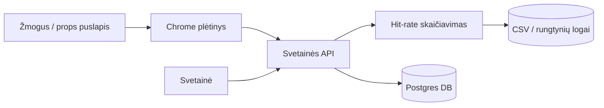

# PropHover

Kursinio darbo I dalis: projektavimo dokumentas

## 1. Problema ir idėja

**Sistema vienu sakiniu:** *PropHover* — Chrome plėtinys (su papildoma svetaine), kuris užvedus pelę ant NBA statymų eilutės (props) parodo, ar žaidėjas istoriškai dažnai peržengia pasirinktą taškų / atkovotų / perdavimų (PTS / REB / AST) ribą.

**Problema ir dabartinis procesas:** Dabar žmonės atidaro daug skirtukų, Excel, skaičiuoja ranka „ar ši riba istoriškai dažnai pavykdavo“. Tai lėta ir nepatogu — trūksta greito atsakymo tiesiai ant props puslapio.

**Nauda:** Per kelias sekundes matai procentą — pataikymo dažnį (hit-rate) — pvz. iš paskutinių 5 ar 10 rungtynių, prieš tą patį varžovą, namie ar išvykoje. Galima pajudinti ribą linijos slankikliu — procentas persiskaičiuoja.

**Naudotojai:** Žmonės, kurie tiria NBA statymų eilutes (props). Jie užveda pelę, skaito rezultatą, filtruoja. Prisijungę gali saugoti savo duomenis.

**Prielaidos:** Mokomojo prototipo duomenys — Kaggle arba HuggingFace NBA rungtynių žurnalai (CSV su taškais / atkovotomis / perdavimais) → pradinių duomenų įkėlimas į Postgres → mūsų hit-rate API skaičiuoja. Galutiniam produktui vėliau numatomas nemokamas išorinis API. Svetainių duomenų surinkimas (nba.com / Basketball-Reference) — ne plane (AI pasiūlė, atmesta). Linija iš puslapio arba įvestis; „pataikė“ = statistika **didesnė** už ribą (ne lygu). Sistema **talpinama serveryje** (ne tik lokaliai). II dalies demonstracijai pakanka plėtinio, hit-rate (filtrai + slankiklis) ir automatinių testų; prisijungimas, žaidėjų palyginimas ir dalijimosi kortelė — vėliau.

## 2. Apimtis

| Funkcija                                               | Ką naudotojas galės atlikti                     | Pagrindinis modulis ar pagalbinė funkcija |
| ------------------------------------------------------ | ----------------------------------------------- | ----------------------------------------- |
| Užvedimo pele kortelė                                  | Užvedus pelę mato santrauką su pataikymo dažniu | Pagalbinė funkcija                        |
| Hit-rate skaičiavimas                                  | Gauna procentą pagal filtrus ir ribą            | Pagrindinis modulis                       |
| Filtrai: paskutinės 5 / 10, varžovas, namie / išvykoje | Siaurina, kurias rungtynes skaičiuoti           | Pagrindinio modulio dalis                 |
| Linijos slankiklis                                     | Keičia ribą — procentas atsinaujina             | Pagrindinio modulio dalis                 |
| Prisijungimas                                          | Prisijungti, išsaugoti savo duomenis            | Pagalbinė funkcija                        |

**Į kursinio darbo apimtį neįeina:** automatinis pelningų linijų ieškojimas, kiti sportai, socialinis srautas / forumas.

## 3. Pagrindinis modulis

**Pavadinimas ir atsakomybė:** Hit-rate (pataikymo dažnio) skaičiavimas. Imame žaidėjo rungtynių istoriją, filtrus ir ribą — grąžiname procentą. Ši logika atskirta nuo mygtukų / ekrano ir nuo duomenų bazės.

**Logika, kurią reikės projektuoti ir testuoti:** Filtrai (paskutinės N, varžovas, namie / išvykoje); pataikymas = statistika > riba; procentas = pataikymų skaičius ÷ rungtynių skaičius; kai rungtynių 0 — rezultato nėra.

**Įvestis:** žaidėjo ID, statistikos tipas (taškai / atkovotos / perdavimai), riba (pvz. 24.5), filtrai. Pavyzdys: taškai, riba 24.5, paskutinės 10, namie. Techniniuose laukuose: `player_id`, `stat`, `line`, `lastN`, `venue`.

**Išvestis:** procentas, kiek pataikė, kiek rungtynių, ir pavyzdinės rungtynės. Pavyzdys: 70 %, 7 iš 10. Techniniuose laukuose: `hitRate`, `hits`, `n`, `sampleGames`.

**Veikimo eiga:**

1. Plėtinys nuskaito žaidėją, tipą, ribą iš puslapio.
2. Serveris atiduoda rungtynių istoriją.
3. Modulis paskaičiuoja procentą.
4. Kortelė parodo rezultatą; pajudinus slankiklį — skaičiuoja iš naujo.

### Taisyklės arba sprendimo žingsniai

1. Jei rungtynių 0 — procentas tuščias + žinutė „nepakanka duomenų“.
2. „Pataikė“ tik kai statistika **griežtai didesnė** už ribą; jei lygu — neskaičiuojam kaip pataikymą.
3. „Paskutinės N“ = naujausios N rungtynės chronologiškai; tada taikomi namie / varžovas filtrai.
4. Leidžiami tik trys tipai (taškai, atkovotos, perdavimai); kitas tipas — klaida.

### Scenarijai būsimiems testams

| Scenarijus                        | Pradinės sąlygos ir konkreti įvestis | Veiksmas                                 | Tikslus laukiamas rezultatas   |
| --------------------------------- | ------------------------------------ | ---------------------------------------- | ------------------------------ |
| Įprastas atvejis                  | 10 rungtynių, 7 kartus taškai > 24.5 | Skaičiuoti su paskutinėmis 10, riba 24.5 | 70 %, n=10                     |
| Ribinis atvejis arba konfliktas   | Statistika lygi ribai                | Skaičiuoti pataikymą                     | Neskaičiuojama kaip pataikymas |
| Klaida arba neįmanomas rezultatas | Filtrai palieka 0 rungtynių          | Skaičiuoti                               | Tuščias rezultatas + žinutė    |

**Jei modulis naudoja AI:** Netaikoma.

## 4. Kokybės atributas

**Pasirinktas atributas:** Našumas (atsako greitis).

**Kodėl svarbus šiai sistemai:** Kortelė turi pasirodyti greitai, kol žmogus dar žiūri į puslapį.

**Tikrinimo scenarijus ir sąlygos:** Vienas žaidėjas, paskutinės 10, taškai; kelis kartus keičiam ribą slankikliu (su paruoštais duomenimis).

**Sėkmės kriterijus:** Tipinis atsakymas greitesnis nei 300 ms su paruoštais logais.

**Numatytas projektavimo sprendimas:** Skaičiavimas serveryje; duomenys surikiuoti pagal žaidėją ir datą; pirma versija be sudėtingo kešavimo.

**Kaip patikrinsiu vėlesniame etape:** Užklausos trukmės matavimas tipiniam paskutinių-10 kvietimui.

**Sprendimo kaina arba ribojimas:** Demonstracija su CSV failu ≠ gyvi interneto duomenys; gyvas / išorinis API vėliau gali būti lėtesnis (užklausų limitai).

## 5. Pradinė sistemos struktūra

### Paprasta schema

| Sistemos dalis   | Atsakomybė                                               |
| ---------------- | -------------------------------------------------------- |
| Chrome plėtinys  | Pelės užvedimas, ribos nuskaitymas, kortelės vaizdas     |
| Svetainė + API   | Skaičiavimo užklausos, prisijungimas, išsaugoti duomenys |
| Hit-rate modulis | Filtrai + palyginimas „statistika > riba“                |
| Postgres / CSV   | Sesijos ir išsaugoti dalykai; rungtynių istorija         |

**Planuojamos technologijos ir pasirinkimo priežastys:** Next.js, React, TypeScript, styled-components, TanStack Query (`useQuery` / `useMutation`), Postgres, NextAuth (arba panaši priemonė) ir Manifest V3 extension. Next.js — svetainė ir API viename projekte; Postgres — struktūruoti rungtynių įrašai ir užklausos pagal žaidėją / datą; Manifest V3 plėtinys — pelės užvedimui ant props puslapio. Svetainė bus talpinama serveryje, ne tik lokaliai.

## 6. AI panaudojimas

### AI rengiant šį dokumentą

| Priemonė ir užduotis                          | Ką panaudojau                                                                                                                                       | Ką atmečiau arba perrašiau ir kodėl                                          | Kaip patikrinau                         |
| --------------------------------------------- | --------------------------------------------------------------------------------------------------------------------------------------------------- | ---------------------------------------------------------------------------- | --------------------------------------- |
| Grupė iš 3 Grok botų (PM, CTO, Product Owner) | padėjo formuluoti, gilintis į dalykinę sritį, išryškinti pagrindinį funkcionalumą, pasakyti ko neverta daryti, suformuoti ataskaitą pagal struktūrą | svetainių duomenų surinkimą kaip duomenų šaltinį; AI kaip hit-rate branduolį | Peržiūra toje pačioje Grok botų grupėje |

### Planuojamas AI naudojimas kuriant sistemą

**Kur ir kam naudosiu AI:** Debesijos agentai įgyvendins užduotis pagal sudarytus task’us "Linear" sisitemoje ir atidarys PR.

**Kaip tikrinsiu pasiūlymus ir sugeneruotą kodą:** PR bei kodą peržiūrėsiu, pakeitimus išbandysiu lokaliai atskiroje šakoje ir, jei viskas gerai, sujungsiu. Po II prototipo atliksiu išsamesnę visos kodų bazės peržiūrą ir pataisymus.

**Ar AI bus sistemos funkcionalumo dalis:** Ne.

## 7. Tolesnių darbų planas

| Darbas                                  | Apčiuopiamas rezultatas                                | Planuojama darbų seka |
| --------------------------------------- | ------------------------------------------------------ | --------------------- |
| MD failas (I dalis)                     | Paruoštas projektavimo dokumentas                      | 1 (iki 2026-10-04)    |
| GitHub + projekto karkasas              | Next.js + plėtinio skeletas                            | 2                     |
| Duomenų modelis + CSV                   | Kaggle/HF logai → Postgres (pradinių duomenų įkėlimas) | 3                     |
| Hit-rate funkcijos + vienetiniai testai | Skaičiavimas + testai                                  | 4                     |
| API maršrutas                           | Hit-rate + filtrai                                     | 5                     |
| Chrome pelės užvedimas                  | HTML struktūra (DOM) + UI + linijos slankiklis         | 6                     |
| Integracija plėtinys ↔ API              | Veikiantis užvedimas pele → API                        | 7                     |
| Prisijungimas + išsaugoti duomenys      | Prisijungimas + saugomi įrašai                         | 8                     |
| README + paleidimas                     | Paleidimo instrukcijos                                 | 9                     |

**Būsimo prototipo veikimo scenarijus:** Props puslapyje užvedi pelę ant taškų linijos → kortelė rodo procentą iš paskutinių 10 → pajudini slankiklį → procentas keičiasi.

| Rizika arba neaiškumas                            | Kaip patikrinsiu arba sumažinsiu               |
| ------------------------------------------------- | ---------------------------------------------- |
| Skirtingos svetainės skirtingai sudėlioja puslapį | Pradėti nuo vienos svetainės                   |
| Trūksta duomenų                                   | Kursinio demonstracijai = Kaggle/HF sezono CSV |
| „> ar ≥“ taisyklė                                 | Užfiksuota + testai                            |

## Šaltiniai, jei naudojote

Nenaudota